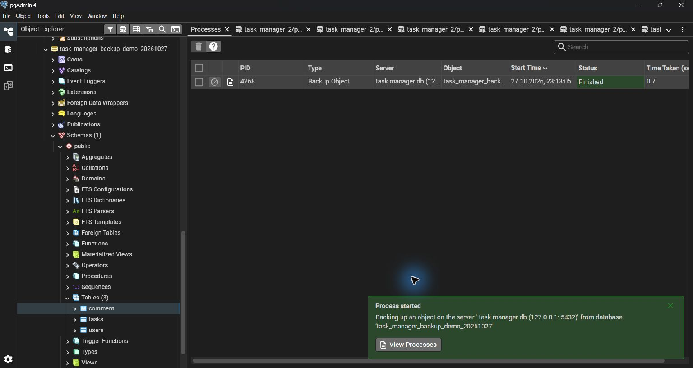
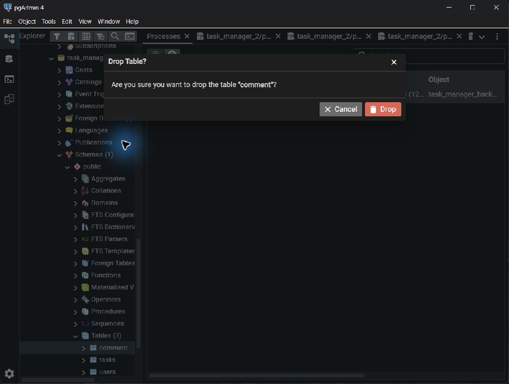
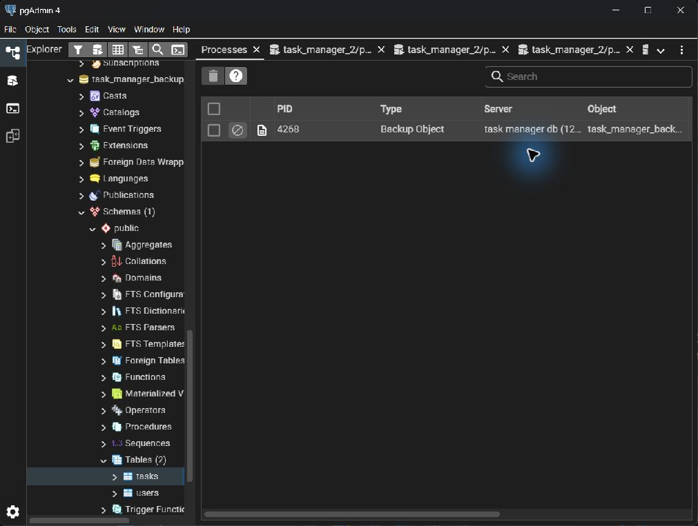
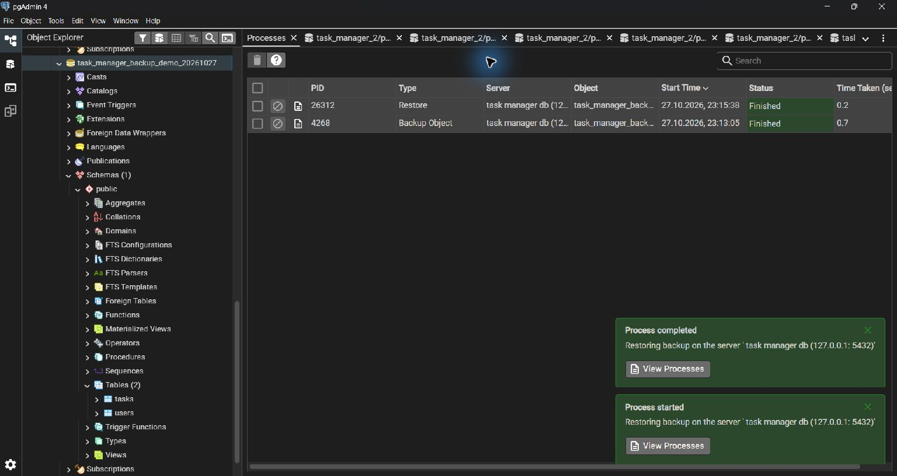
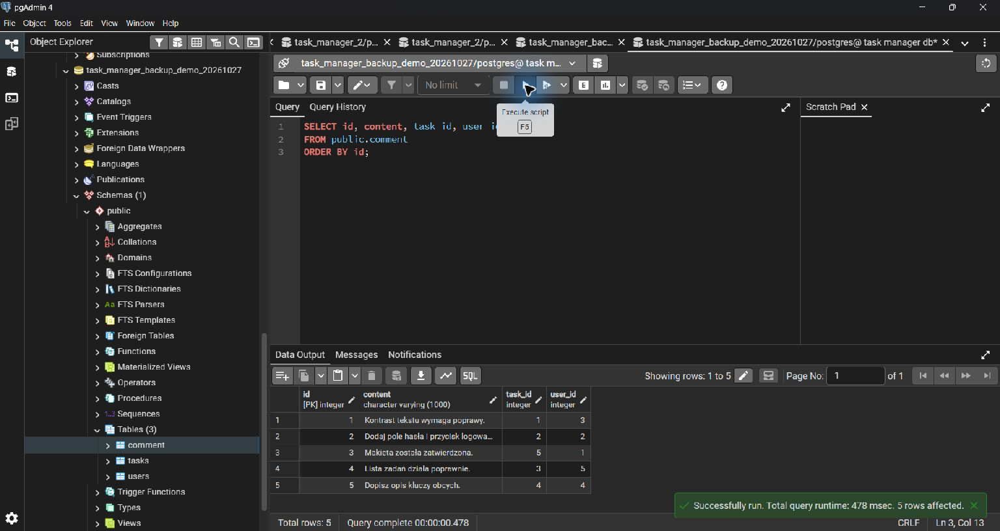

# Administracja bazy danych — kopia i uprawnienia

## Kopia zapasowa i przywrócenie

Pierwszą kopię tabeli `public.comment` w bazie `task_manager_2` wykonano w pgAdmin 16.10.2026. Zrzut ekranu pokazuje status `Finished`. Wtedy nie usuwano tabeli z tej bazy.

Pełny test odtworzenia przeprowadzono 27.10.2026 **w oddzielnej bazie** `task_manager_backup_demo_20261027`. W bazie testowej uruchomiono `database/table-schema.sql` i `database/seed-data.sql`. W pgAdmin wykonano nową kopię tabeli `public.comment` w formacie Custom do lokalnego pliku `backup-demo/comment-pgadmin.backup` (poza repozytorium). Archiwum zawierało definicję tabeli, jej 5 rekordów, klucz główny i oba klucze obce. Zarówno Backup, jak i Restore zakończyły się statusem `Finished`.

| Krok | Polecenie lub sprawdzenie | Wynik |
|---|---|---|
| Przed usunięciem | `SELECT COUNT(*) FROM public.comment;` | 5 rekordów |
| Usunięcie w bazie testowej | Drop na tabeli `public.comment` w pgAdmin | `Tables (2)` |
| Potwierdzenie braku | Schemas → public → Tables | `comment` nie ma |
| Przywrócenie | Restore w pgAdmin z archiwum Custom do bazy testowej | `Finished` |
| Sprawdzenie po przywróceniu | `SELECT id, content, task_id, user_id FROM public.comment ORDER BY id;` | 5 rekordów, jak przed usunięciem |

Właściwą kopię należy przechowywać poza komputerem z bazą, np. na zewnętrznym dysku albo serwerze. Awaria jednego dysku może zniszczyć jednocześnie bazę i kopię, jeśli oba pliki są na tym samym nośniku. Osobny folder lub litera partycji na tym samym dysku nie rozwiązuje tego problemu. Plik w `backup-demo` posłużył tylko do lokalnego testu.

[Dokument Word z instrukcją i pięcioma zrzutami z testu pgAdmin](backup-restore-pgadmin.docx).

## Rola tylko do odczytu

Skrypt [`database/role-select.sql`](../database/role-select.sql) tworzy rolę `userek` i nadaje jej `CONNECT`, `USAGE` oraz `SELECT` na trzech tabelach. Rola nie otrzymuje `INSERT`. Sprawdzenie wykonano w pgAdmin przez `SET ROLE userek`, a potem `RESET ROLE`.

1. Jako `userek` zapytania `SELECT` z tabel `users`, `tasks` i `comment` działały. Każda tabela miała wtedy 5 rekordów.

   

2. Próba `INSERT` do `public.comment` jako `userek` zwróciła `permission denied for table comment`, kod PostgreSQL `42501`. Rekord nie został dodany.

   

3. Po `RESET ROLE` administrator mógł wykonać `INSERT`; PostgreSQL zwrócił nowy rekord.

   

Pełny opis i zrzuty są również w [dokumencie Word o rolach](administracja-db-roles.docx). Wyniki ze zrzutów dotyczą bazy `task_manager_2`; test przywracania z pierwszej sekcji wykonano osobno i nie zmieniał tej bazy.
