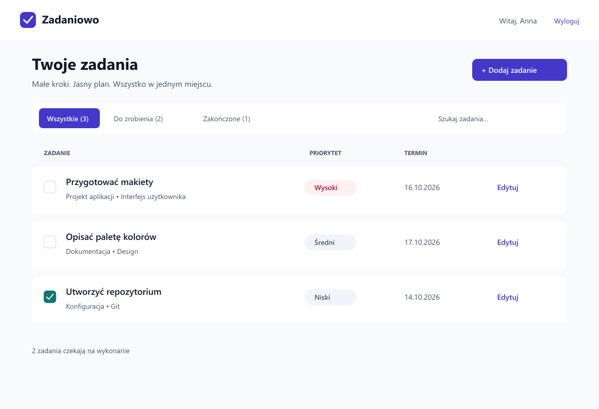
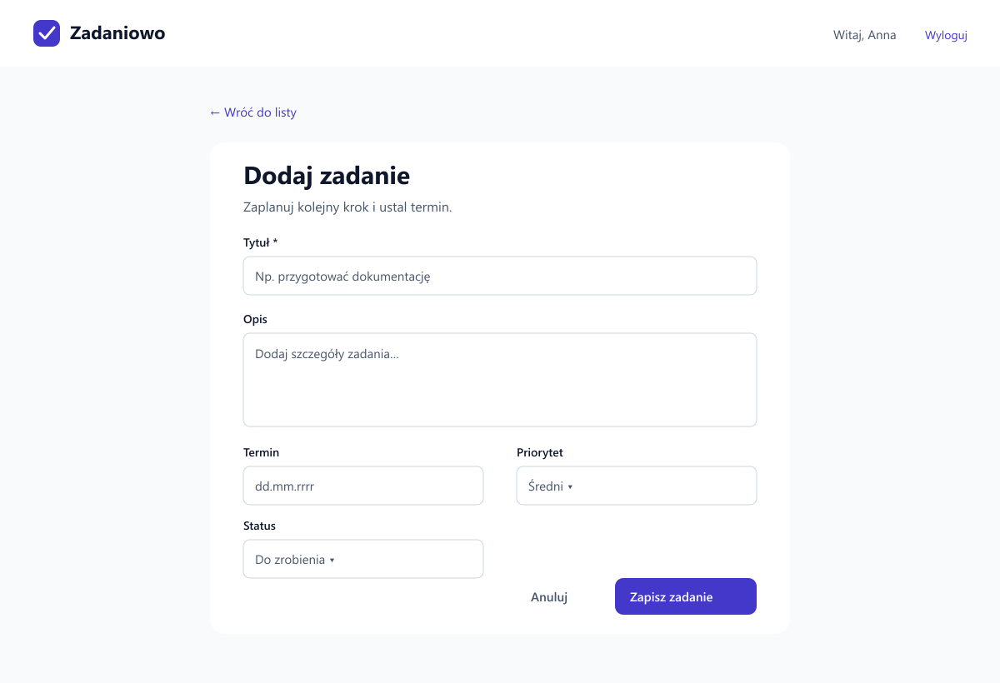
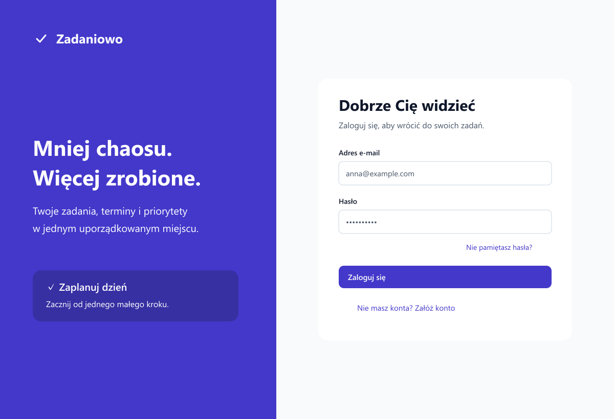

# Zadaniowo — projekt wyglądu aplikacji

Materiały na drugi dzień praktyk: lista zadań, formularz dodania/edycji, logowanie, paleta, typografia i logo. Projekt zakłada prosty menedżer osobistych zadań.

## Projekt w Figma

[Otwórz projekt Zadaniowo w Figma](https://www.figma.com/design/B7n1bk5PJCKAuLwpqePFeU?node-id=1-2)

Plik zawiera trzy makiety ekranów oraz paletę kolorów, typografię i logo na stronie „Makiety i system wizualny”.

## Makiety

- [Lista zadań](design/task-list.png)
- [Formularz dodania/edycji](design/task-form.png)
- [Logowanie](design/login.png)

### Lista zadań

Przycisk „Dodaj zadanie” prowadzi do formularza. Filtry i wyszukiwarka ograniczają listę; checkbox zmienia status na „Zakończone”. „Edytuj” otwiera formularz z danymi wybranego zadania. Priorytet ma etykietę tekstową, aby kolor nie był jedynym nośnikiem informacji.

### Dodanie / edycja zadania

W trybie edycji nagłówek brzmi „Edytuj zadanie”, a pola zawierają istniejące dane. Tytuł jest wymagany (1–120 znaków po usunięciu spacji na brzegach); opis, termin i priorytet są opcjonalne. Domyślny priorytet: średni; status: do zrobienia. Pusty tytuł pokazuje komunikat „Wpisz tytuł zadania” pod polem. Zapis przekierowuje na listę i pokazuje „Zadanie zapisane”. Anulowanie wraca bez zapisu.

### Logowanie

Pola: e-mail i hasło, przycisk logowania oraz odnośniki odzyskania hasła i rejestracji (do wdrożenia w późniejszym etapie). Przy błędzie: „Nieprawidłowy e-mail lub hasło”. Podczas wysyłania: „Logowanie…” i blokada ponownego wysłania.

## Paleta kolorów

| Rola | HEX | Zastosowanie |
|---|---|---|
| Główny | #4338CA | Przyciski, linki, aktywne filtry |
| Dodatkowy | #0F766E | Oznaczenie wykonania zadania |
| Tło | #F8FAFC | Tło ekranów |
| Tekst | #0F172A | Nagłówki i podstawowy tekst |
| Tekst pomocniczy | #475569 | Opisy i etykiety |
| Powierzchnia | #FFFFFF | Karty i pola formularzy |
| Obramowanie | #CBD5E1 | Dekoracyjne separatory i pola |
| Błąd / wysoki priorytet | #9F1239 | Komunikaty; tło #FFF1F2 |

### Kontrast

Współczynniki obliczone według luminancji względnej sRGB: zwykły tekst powinien mieć co najmniej 4,5:1.

| Para | Kontrast |
|---|---|
| Tekst / tło | 17.06:1 |
| Tekst pomocniczy / biel | 7.58:1 |
| Biel / główny | 7.90:1 |
| Biel / dodatkowy | 5.47:1 |
| Błąd / jasne tło | 7.30:1 |

## Typografia

- Nagłówki: [Manrope](https://fonts.google.com/specimen/Manrope), 700; 30–32 px (główny nagłówek), 20–24 px (sekcja). Geometryczna forma pasuje do prostego znaku i wyraźnie wyróżnia hierarchię.
- Treść: [Inter](https://fonts.google.com/specimen/Inter), 400; 16 px, interlinia 1,5. Wybrany ze względu na czytelne etykiety i liczby w tabeli zadań. Przyciski i etykiety: 600.
- Fonty zastępcze: Segoe UI, Arial, sans-serif. W katalogu `docs/design` znajdują się obrazy PNG ekranów; edytowalny projekt z wybranymi fontami jest dostępny przez link do Figma.

## Logo

Logo Zadaniowo jest widoczne na każdym ekranie oraz w projekcie Figma.

Biały znak zatwierdzenia w fioletowym kwadracie z zaokrąglonymi rogami oznacza wykonane zadanie. Prosty znak działa jako ikona aplikacji oraz obok nazwy. Minimalny zalecany rozmiar znaku: 24 × 24 px.

## Układ i dostępność

Makiety desktopowe mają 1200 × 820 px. Siatka odstępów: 8 px; zaokrąglenia kart: 12–18 px. Na telefonie (poniżej 768 px) formularz i lista zajmują jedną kolumnę; w logowaniu panel promocyjny znika. Filtry mogą przewijać się poziomo. Przyciski mają wysokość co najmniej 44 px.

We wdrożeniu: etykiety powiązane z polami, obsługa klawiaturą, widoczny fokus w kolorze głównym, komunikaty błędów odczytywane przez czytniki ekranu. Pusta lista: „Nie masz jeszcze zadań” i przycisk dodania. Brak wyników: „Nie znaleziono zadań”; błąd pobierania: „Nie udało się pobrać zadań” z przyciskiem ponowienia.

## Zakres materiałów

To makiety i specyfikacja projektu, bez połączenia z backendem. Obrazy PNG przedstawiają statyczne ekrany; przyciski na obrazach nie są interaktywne. Trzy obrazy znajdują się w katalogu `docs/design`, a edytowalny projekt w Figma. Materiały są w osobnym branchu `design`.
