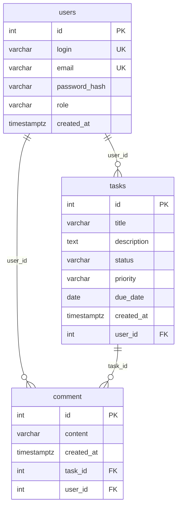

# Diagram ERD bazy Zadaniowo

Diagram odpowiada aktualnemu skryptowi [`database/table-schema.sql`](../database/table-schema.sql). Baza PostgreSQL zawiera trzy tabele: `users`, `tasks` i `comment` (liczba pojedyncza).

`PK` oznacza klucz główny, `FK` klucz obcy, a `UK` wartość unikalną. Jeden użytkownik może mieć wiele zadań i komentarzy. Jedno zadanie może mieć wiele komentarzy. Kolumny `tasks.priority` i `tasks.due_date` są również dodawane do starszej bazy przez [`database/migrate-task-details.sql`](../database/migrate-task-details.sql).
